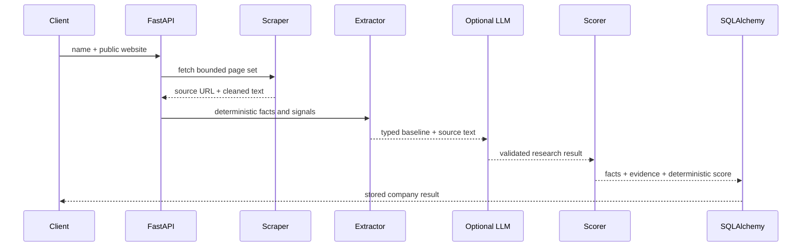

# Architecture

SignalForge is a single FastAPI service with explicit boundaries between collection, interpretation, policy, and storage. This keeps the demo easy to run while leaving each part independently replaceable.

## Request flow

## Components

- `app/api`: HTTP validation, CSV parsing, response codes, and query endpoints.
- `app/services/scraper.py`: controlled requests, retries, page limits, HTML cleanup, and redirect handling.
- `app/services/url_safety.py`: DNS resolution and rejection of non-public IP space for every requested URL.
- `app/services/extraction.py`: weighted baseline extraction with field evidence and confidence.
- `app/services/research.py`: evidence discovery driven by the active ICP's configured terms.
- `app/services/llm.py`: provider-neutral OpenAI chat-completions call with a Pydantic JSON schema. It falls back to the baseline on provider failure.
- `app/services/scoring.py`: loads the ICP JSON and calculates all points. The LLM never supplies component or total scores.
- `app/models.py`: normalized company, signal, and one-to-one score records.

## Trust boundaries

Website URLs are untrusted input. Pydantic rejects invalid schemes and credentials, then DNS validation rejects private and special-use destinations. Redirects are followed manually so each destination is checked. Fetches have time, byte, page, and retry limits. HTML scripts and styles are removed before analysis.

Website content and LLM output are also untrusted. LLM responses must pass the `ResearchResult` schema. Evidence must occur in the fetched text and source hosts must match fetched hosts. If validation or the provider fails, the pipeline uses deterministic results.

## Data and database portability

`Company` owns many `Signal` rows and one `Score`. SQLAlchemy 2 typed models use types shared by SQLite and PostgreSQL. SQLite's thread option is applied only to SQLite URLs. For production, Alembic migrations would replace startup table creation.

## Scoring behavior

The policy file contains target industries, business models, employee bounds, evidence terms, and weights. The five weights must total 100. Each component reads only its relevant field or signals, and missing evidence always produces zero points. Confidence determines whether matching evidence receives full, partial, or zero credit. Size uses an observed range and range overlap; repeated signals in one category cannot inflate a result.

## Failure behavior

- Unsafe input returns `400`.
- Unreachable or unusable sites return `502` for single analysis.
- Batch analysis captures expected failures per row and continues.
- Missing records return `404`.
- Database health failure returns `503`.
- LLM failure is logged and falls back to deterministic analysis.
